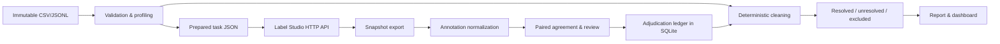

# Data Annotation and Quality Pipeline

This is a text-classification data-operations pipeline. It validates source records, prepares independent Label Studio tasks, imports and exports through the Label Studio REST API, normalizes complete per-task annotation history, aligns annotators by stable source ID, computes raw agreement and Cohen's kappa, flags issues, records append-only adjudication, cleans deterministically, and exports validated labeled, unresolved, and excluded splits with a reproducible report.

The bundled example data and the unit and E2E test fixtures are synthetic example records, not human annotations.

## Architecture



The CLI is split into focused modules: `validation`, `profiling`, `label_studio`, `annotations`, `agreement`, `review`, `cleaning`, `storage`, and `reporting`. The dashboard reads the same run files rather than computing independent scores. `results/<version>-<hash>/manifest.json` freezes the resolved configuration, original-file SHA-256, and implementation source-code hash. Each stage produces a distinct artifact, and the raw copy is checked for integrity before reuse.

## Setup

The core packages are pinned for Python 3.11–3.13 (Python 3.13.5 is tested locally). The primary integration uses documented HTTP APIs and `requests`, not the legacy SDK. The optional SDK extra pins v2.1.2 (released September 2026) for teams building additional SDK integrations.

```bash
cd annotaflow
python3.13 -m venv .venv   # alternatively python3.11 or python3.12
source .venv/bin/activate # Windows PowerShell: .venv\Scripts\Activate.ps1
python -m pip install --upgrade pip
python -m pip install -e '.[dev,dashboard]'
# optional: python -m pip install -e '.[sdk,parquet]'
python -m pytest -q
ruff format .
ruff check .
```

To run a module directly from the source tree instead of the installed entry point, use `PYTHONPATH=src python -m annotaflow`. The test suite never requires Label Studio.

### 1. Configure source and ontology

Edit `configs/dataset.yaml` (`path`, columns, allowed categories/sources, min length, encoding, version), `configs/annotation.yaml` (labels, definitions, guideline version), `configs/quality.yaml` (candidate near duplicates and optional seeded bootstrap intervals), and `configs/cleaning.yaml` (whitespace normalization, aliases, duplicate policy, unresolved exclusion). Labels in the source file do not enter the labeling interface. Before recruiting annotators, read `docs/annotation_guidelines.md` and keep the same guideline version for both raters.

CSV and JSONL require the configured text column. ID/label/source/category fields are optional; missing IDs are generated by deterministic SHA-256 of canonical source row content; exact identical ID-less rows collide and are flagged rather than arbitrarily assigned a suffix. JSONL malformed lines are counted and their raw text preserved in the report. Parquet is supported when `pyarrow` is installed.

### 2. Run the offline pipeline

```bash
annotaflow validate
annotaflow profile
annotaflow prepare
annotaflow run-offline   # validation, profile, preparation, cleaning, report
annotaflow report
```

Results go in `results/<dataset-version>-<sha-prefix>/`. `run-offline` does not create annotations, so the example's six records stay unresolved until they are adjudicated with supporting evidence.

### 3. Run your own Label Studio service

Install and launch Label Studio using the deployment's official installation instructions. A typical local launch, after installing the `label-studio` distribution in its own Python environment, is:

```bash
python -m pip install label-studio
label-studio start --port 8080
```

Current install instructions are at https://labelstud.io/guide/install; check the version for your OS. For the Label Studio API, configure secrets through your terminal or session (never commit `.env`):

```bash
export LABEL_STUDIO_URL=http://localhost:8080
export LABEL_STUDIO_API_KEY='your-token-from-the-UI'
export LABEL_STUDIO_TOKEN_TYPE=pat # or legacy
annotaflow project               # create a project allowing two annotations per task
# OR: annotaflow project --project-id 123  (validate an existing project)
annotaflow import                # dedupe by source_id, verify remote count & identity
```

For personal access tokens, the HTTP client POSTs the refresh token to `/api/token/refresh`, then authorizes requests with the issued short-lived Bearer access token and retries one 401 after refresh. A legacy token uses `Authorization: Token`. Connection, import, config validation, and task identity are checked against the server responses, and server or API failures stop processing. Users with a restricted role may see a filtered task inventory; use a manager or owner with permission to read all annotations. The project is configured with `maximum_annotations=2` and `show_annotation_history=false`; organizational permissions must independently ensure annotators cannot see or edit each other's answers.

### 4. Independently label an overlapping subset

Recruit two distinct Label Studio users and assign the same records for independent annotation. The default project permits two annotations per task, so the entire imported set can be overlapping; for a controlled subset, import a separate deterministic subset in a separate project or run and retain the subset manifest. Each annotator must read the same guidelines, choose one substantive label, or skip cases that are unclassifiable. Do not train raters against each other's current responses, and do not use old source labels as previews. Record the two user IDs from the export and grant administrative access only to the adjudicator.

### 5. Export, align and analyze

```bash
annotaflow export                 # asynchronous snapshot, wait for completion, JSON download
annotaflow analyze --a 101 --b 202
annotaflow review --a 101 --b 202
```

Replace 101 and 202 with your own rater IDs. The export is an immutable timestamped copy in `raw_annotation_snapshots/`, plus `raw_annotations.json` (current pointer or copy). All annotations, even skipped or invalid ones, are preserved and normalized, and previously imported source IDs are checked. Exports are checked against the remote task inventory before being accepted. `normalize` also accepts your already exported native Label Studio JSON (not flattened `JSON_MIN` or a generic CSV):

```bash
annotaflow normalize --file /absolute/path/to/label_studio_export.json
annotaflow analyze --a RATER_ID_1 --b RATER_ID_2
```

Kappa is computed by `sklearn.metrics.cohen_kappa_score`, paired by record ID, with explicit label order, only when there is exactly one valid submission from each rater for that ID. Missing, skipped, invalid, and duplicate-submission pairs are excluded with counts and reasons. No numeric quality score is reported when there are no valid pairs. Nominal sentiment classes use unweighted kappa. To compute ordinal weights for an explicitly ordinal ontology, use `--ordinal --weights linear` or `--ordinal --weights quadratic`; these are not appropriate for the default nominal sentiment ontology.

### 6. Inspect, adjudicate, clean

```bash
annotaflow review --a RATER_ID_1 --b RATER_ID_2
annotaflow adjudicate --id s001 --reviewer reviewer-1 --label Positive \
  --reason 'Reviewed the exact operational definition and source context'
# or: annotaflow adjudicate --id s001 --reviewer reviewer-1 --unresolved \
#   --reason 'Insufficient context; request relabeling'
annotaflow clean --a RATER_ID_1 --b RATER_ID_2
annotaflow report
streamlit run app/streamlit_app.py
```

Without `--a/--b`, an adjudicated record can resolve but no inferred agreement is accepted. Annotator labels are never overwritten; a second adjudication creates a new decision revision. For every record, the cleaning ledger records operations (including `no_change`), status, and exclusions. The pipeline generates `resolved.csv/.jsonl`, `unresolved`, `excluded`, `cleaned_all`, `review_queue.json`, `adjudication_history.json`, `normalized_annotations`, and `quality_report.md/.json` with figures in `plots/`. Public labeled exports contain class labels without private annotator IDs. The restricted raw and normalized exports and the SQLite database may contain user identifiers and should be access-controlled.

`review_queue.json` includes unresolved source errors, conflicting or missing labels, duplicate submissions, skipped results, existing-label conflicts, and duplicate metadata conflicts. The Streamlit console has six analysis and inspection pages plus an adjudication form. Re-run `clean` and `report` after reviewer decisions to refresh derived artifacts. `--root /path/to/repo` may be used with all CLI commands.

## Output contract

| File | Meaning |
|---|---|
| `manifest.json` | Immutable data SHA-256, config hash, run/guideline/dataset versions |
| `raw/<input>` | Byte-preserved source snapshot |
| `validated_records.json`, `validation_report.json` | Source provenance, every parsed row, row issues and malformed-line counts |
| `profile.json`, `plots/` | Measured statistics and possible near-duplicate candidates |
| `prepared_tasks.json`, `label_config.xml` | Label Studio-compatible task objects and interface XML |
| `project.json`, `audit.sqlite` | Verified project ID; append-only events, mappings and adjudication revisions |
| `raw_annotation_snapshots/*.json`, `raw_annotations.json` | Native Label Studio export |
| `normalized_annotations.json/.csv` | One normalized row per annotation, plus explicit missing-task rows |
| `agreement.json` | Pair counts, observed/expected agreement, kappa, confusion matrix, per-class metrics and caveats |
| `review_queue.json`, `adjudication_history.json` | Flag reasons, full annotation history, decisions with reviewer and version |
| `cleaning_ledger.json` | Every row's deterministic transformation and resulting status |
| `resolved`, `unresolved`, `excluded`, `cleaned_all` | Separately validated CSV and JSONL exports |
| `quality_report.md/.json`, `plots/*.png` | Reproducible measured findings and stated limitations |

Privacy, consent and quality guardrails: the software does not assess whether human annotators gave correct labels, and agreement alone is insufficient. Near-duplicate cosine similarity is a review suggestion, never a deduplication decision. No class balancing or minority-class deletion is done automatically. Text whitespace normalization suits document-level classification but not span-offset labeling. Keep administrative dashboard and report files private, arrange consent and retention for source text and worker identifiers, and share only sanitized exports.

## Limitations

- The unit tests and offline E2E tests use labeled JSON built as synthetic software fixtures; they exercise the algorithms, not an annotation service.
- `ANNOTAFLOW_LIVE=1 pytest -m live` runs a read-only live integration smoke test when credentials and a service are supplied.
- Snapshot status and the remote JSON schema are revalidated, but server-specific authorization, user roles, export defaults, and task assignment policy depend on the target deployment. A project with incompatible settings is rejected rather than silently changed.
- A new run ID is created when the source bytes or the resolved configuration changes. SQLite adjudications remain in the prior run, so review and re-record decisions under the new guideline version rather than reusing them silently.
- The dashboard is a local internal administrative interface, not a multi-tenant production web service. Do not expose it without authentication and authorization controls.
- Exact duplicate rows with conflicting source, category, existing, or resolved labels are held for human review. Setting `exclude_unresolved: true` excludes unresolved records with reasons; the default is false.

## Documentation index

Read [annotation guidelines](docs/annotation_guidelines.md), [label schema](docs/label_schema.md), [methodology and architecture](docs/methodology.md), [agreement metrics](docs/agreement_metrics.md), [cleaning policy](docs/cleaning_policy.md), [lineage and privacy](docs/lineage.md), [troubleshooting](docs/troubleshooting.md), and [project report outline](docs/project_report_outline.md).

## API references

[Label Studio access tokens](https://labelstud.io/guide/access_tokens), [project creation](https://api.labelstud.io/api-reference/api-reference/projects/create), [project label-config validation](https://api.labelstud.io/api-reference/api-reference/projects/validate-label-config/), [task import](https://api.labelstud.io/api-reference/api-reference/projects/import-tasks), [list tasks](https://api.labelstud.io/api-reference/api-reference/tasks/list), [create export snapshot](https://api.labelstud.io/api-reference/api-reference/projects/exports/create), [snapshot status](https://api.labelstud.io/api-reference/api-reference/projects/exports/get), [snapshot download](https://api.labelstud.io/api-reference/api-reference/projects/exports/download), [SDK v2 documentation](https://api.labelstud.io/api-reference/introduction/getting-started).
